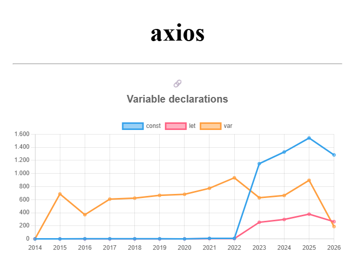

# Explorando evolução de código

Neste exercício, iremos explorar a evolução de código em sistemas reais.

Iremos utilizar a ferramenta [GitEvo](https://github.com/andrehora/gitevo).
Essa ferramenta analisa a evolução de código em repositórios Git nas linguagens Python, JavaScript, TypeScript e Java, e gera relatórios `HTML` como [este](https://andrehora.github.io/gitevo-examples/python/pandas.html).

Mais exemplos de relatórios podem ser podem ser encontrados em https://github.com/andrehora/gitevo-examples.

# Passo 1: Selecionar repositório a ser analisado

Selecione um repositório relevante na linguagem de sua preferência (Python, JavaScript, TypeScript ou Java).
Você pode encontrar projetos interessantes nos links abaixo:

- Python: https://github.com/topics/python?l=python
- JavaScript: https://github.com/topics/javascript?l=javascript
- TypeScript: https://github.com/topics/typescript?l=typescript
- Java: https://github.com/topics/java?l=java

# Passo 2: Instalar e rodar a ferramenta GitEvo

> [!NOTE]
> Antes de instalar a ferramenta, é recomendado criar e ativar um [ambiente virtual Python](https://packaging.python.org/en/latest/guides/installing-using-pip-and-virtual-environments/#create-and-use-virtual-environments).

Instale a ferramenta [GitEvo](https://github.com/andrehora/gitevo) com o comando:

```
$ pip install gitevo
```

Execute a ferramenta no repositório selecionado utilizando o comando abaixo (ajuste conforme a linguagem do repositório).
Substitua `<git_url>` pela URL do repositório que será analisado:

```shell
# Python
$ gitevo -r python <git_url>

# JavaScript
$ gitevo -r javascript <git_url>

# TypeScript
$ gitevo -r typescript <git_url>

# Java
$ gitevo -r java <git_url>
```

Por exemplo, para analisar o projeto Flask escrito em Python:

```
$ gitevo -r python https://github.com/pallets/flask
```

> [!NOTE]
> Essa etapa pode demorar alguns minutos pois o projeto será clonado e analisado localmente.

# Passo 3: Explorar o relatório de evolução de código

Após executar a ferramenta [GitEvo](https://github.com/andrehora/gitevo), é gerado um relatório `HTML` contendo diversos gráficos sobre a evolução do código.

Abra o relatório `HTML` e observe com atenção os gráficos.

# Passo 4: Explicar um gráfico de evolução de código

Selecione um dos gráficos de evolução e explique-o com suas palavras.
Por exemplo, você pode:

- Detalhar a evolução ao longo do tempo
- Detalhar se as curvas estão de acordo com boas práticas
- Explicar grandes alterações nas curvas
- Explorar a documentação do repositório em busca de explicações para grandes alterações
- etc.

Seja criativo!

# Instruções para o exercício

1. Crie um `fork` deste repositório (mais informações sobre forks [aqui](https://docs.github.com/pt/pull-requests/collaborating-with-pull-requests/working-with-forks/fork-a-repo)).
2. Adicione o relatório `HTML` no seu fork.
3. No Moodle, submeta apenas a URL do seu `fork`.

Responda às questões abaixo diretamente neste arquivo `README.md` do seu fork:

1. Repositório selecionado: https://github.com/axios/axios

   Relatório gerado: [report_axios.html](report_axios.html) (dados brutos em [report_axios.csv](report_axios.csv)), obtido com:

   ```
   $ gitevo -r javascript -f 2014 https://github.com/axios/axios
   ```

2. Gráfico selecionado: **Variable declarations** (declarações de variáveis: `var`, `let` e `const`)

   

3. Explicação:

   O gráfico mostra quantas vezes cada forma de declarar variáveis (`var`, `let` e `const`) aparece no código JavaScript do axios, ano a ano. O GitEvo analisa um commit do início de cada ano, então cada ponto mostra o estado do projeto em janeiro daquele ano. Dá para dividir a história em três fases.

   **Fase 1 (2015 a 2022): só `var`.** Por sete anos o axios foi escrito em ES5 com CommonJS (`require`/`module.exports`), e praticamente toda variável era declarada com `var`. `const` e `let` ficam perto de zero o tempo todo (no máximo 8 ocorrências). O número de `var` cresce devagar, de cerca de 600 para 934, acompanhando o crescimento do código (de ~6,8 mil para ~10,3 mil linhas). Essa escolha fazia sentido no começo: o axios roda no navegador, e por muito tempo era preciso suportar navegadores antigos (como o Internet Explorer) sem passar por um transpilador. O lado ruim é que `var` tem escopo de função e sofre *hoisting*, o que facilita bugs, como variáveis "vazando" de blocos `if`/`for` ou sendo redeclaradas sem querer.

   **Fase 2 (2022 → 2023): a grande virada.** Entre os pontos de 2022 e 2023 a curva de `const` salta de 8 para 1.150 e `let` de 5 para 254, enquanto `var` cai de 934 para 629. Essa é a maior mudança do gráfico e tem uma causa clara no histórico do projeto: o PR [#4787 "Axios ES2017"](https://github.com/axios/axios/pull/4787) (junho de 2022) reescreveu a pasta `lib/` usando ES modules (`import`/`export`), classes e `const`/`let`, e isso foi lançado na [versão 1.0.0](https://github.com/axios/axios/releases/tag/v1.0.0) (outubro de 2022). No mesmo período o código quase dobrou (de 10,3 mil para 18,4 mil linhas), e outros gráficos do relatório mostram a mesma modernização: `arrow_function` passa de 9 para 341, `class_declaration` de 0 para 12 e `await_expression` de 1 para 93.

   **Por que `var` não zerou logo depois da migração?** Depois de 2023 a pasta `lib/` não tem mais nenhum `var`. Os `var` restantes (629 em 2023, 896 em 2025) estavam em dois lugares:
   - **`dist/`**: os arquivos compilados (*bundles*) que eram versionados junto com o código-fonte. Eles são gerados automaticamente e transpilados para ES5, então ficam cheios de `var`. Em janeiro de 2025 eram 444 `var` só nessa pasta.
   - **testes antigos**: a pasta `test/` ainda estava escrita no estilo antigo (113 `var` em 2025).

   **Fase 3 (2025 → 2026): limpeza.** Em 2026 `var` despenca de 896 para 189. Duas mudanças explicam isso: o PR [#7002 "removing dist files from src"](https://github.com/axios/axios/pull/7002) (setembro de 2025) tirou os arquivos compilados do repositório, e o PR [#7489 "refresh test suite to be modernised"](https://github.com/axios/axios/pull/7489) (março de 2026) migrou os testes para o Vitest e removeu arquivos antigos. Por isso o número de linhas de código também cai, de 23 mil para 16,9 mil. Os poucos `var` restantes estão quase todos em testes (178) e em arquivos de configuração do build.

   **Boas práticas.** O estado final segue o que se recomenda hoje para JavaScript moderno (e o que regras de lint como `no-var` e `prefer-const` do ESLint exigem): `const` por padrão (1.283), `let` só quando a variável precisa ser reatribuída (264), e `var` quase eliminado (189). A proporção entre `const` e `let`, cerca de 5 para 1, indica que a maioria das variáveis do projeto não é reatribuída, o que deixa o código mais previsível. O gráfico também mostra um detalhe sobre métricas: o pico de `var` em 2025 não queria dizer que o código-fonte estava piorando, e sim que havia código gerado (`dist/`) versionado no repositório. Não versionar artefatos de build é outra boa prática, e o axios passou a seguir isso em 2025.
